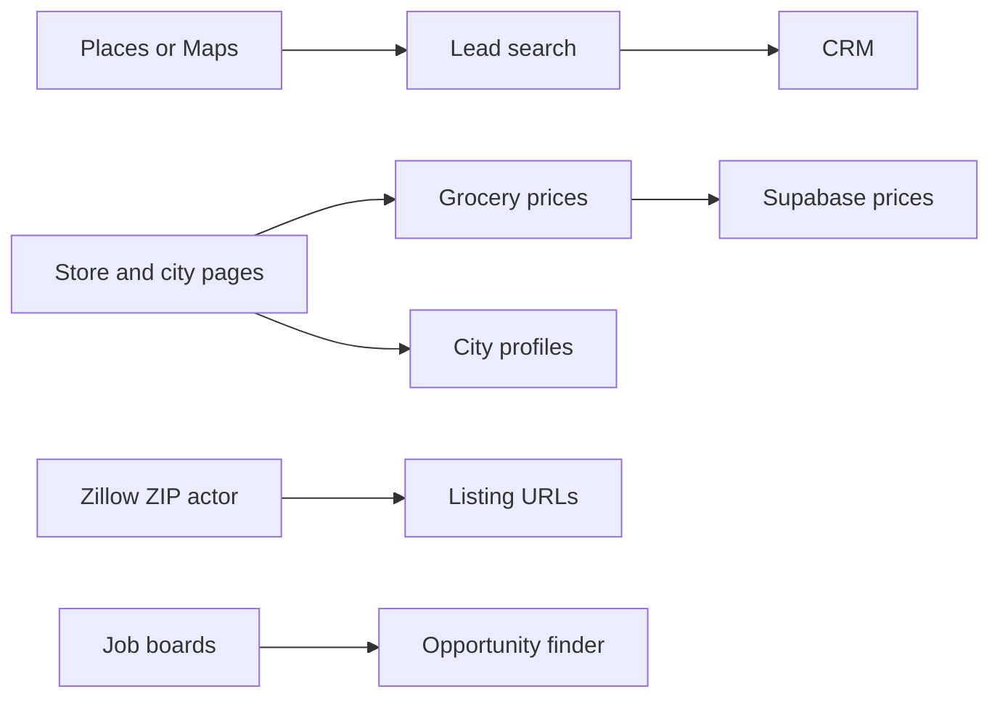

# How it works

These are the tools that live in this repo. Each one has a folder under `scripts/` and, where the picture is generated, a diagram on the repo map. This page is the short version. It is not an API reference.

## Main paths

- **Lead search** finds businesses, can enrich a contact, and can create a CRM lead. Diagram: [lead generation](site:repo-map/leadgen.html).
- **Grocery prices** reads ShopRite, Costco, and Amazon pages and writes prices to Supabase. Diagram: [grocery](site:repo-map/grocery.html).
- **City profiles** reads city-data.com into JSON. The same scraper is also an Apify actor. Diagram: [city data](site:repo-map/city-data.html).
- **Listing URLs** are the Zillow ZIP search used by Property Portal. Diagram: [Zillow](site:repo-map/zillow.html).
- **Opportunity finder** collects remote and contract openings and can upload kept rows to the CRM. Diagram: [opportunity finder](site:repo-map/opp-finder.html).

Script Manager is the local and GitHub Actions entry for a registered script. It can also deliver a run summary to the admin dashboard or the property portal. Diagram: [Script Manager](site:repo-map/script-manager.html).

The hand-written picture of inputs and outputs is [data flow](site:repo-map/data-flow.html). The folder-level import picture is the [repo diagram](site:repo-map/repo.html).

## Where the code lives

GitHub: [StaticxViper/cjm-dev](https://github.com/StaticxViper/cjm-dev/tree/main/scripts), folder `scripts/`.
