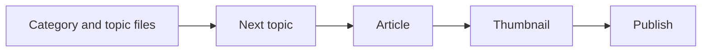

# How it works

Chikara Realms is a blog about personal development and investing. The site itself is not in this repo. This repo runs the pipeline that picks the next topic, writes the post, makes a thumbnail, and publishes it.

## Product

Readers get articles on health, investing, mindset, and philosophy. Each parent category has a queue of subtopics. The public site URL is not recorded here yet.

## Main flow

1. Load subcategories from `blog_category.json`.
2. Take the next title from that subcategory's topic file. When the file is empty, GPT-4 writes 60 titles and the pipeline uses the first one.
3. Perplexity writes the article.
4. DALL-E 3 makes the thumbnail from `img_prompt.txt` plus the topic.
5. The post is sent to the Supabase `manage-blog` function. Nothing is saved as a local article file.

## Backend

The script is `scripts/chikara_realms/blog_automation.py`. It uses the shared HTTP helper and logger. Secrets it expects are `CHATGPT_API_KEY`, `PERPLEXITY_API_KEY`, and `CHIKARA_REALMS_SECRET`.

Run it from `scripts/chikara_realms` with `python blog_automation.py`. The Script Manager name is `blog-automation`. There is no separate GitHub Actions workflow for it.

## Where the code lives

GitHub: [StaticxViper/cjm-dev](https://github.com/StaticxViper/cjm-dev/tree/main/scripts/chikara_realms), folder `scripts/chikara_realms`.

The longer operator notes stay in [the script guide](https://github.com/StaticxViper/cjm-dev/blob/main/documentation/scripts/blog_automation.md). The picture of how this folder connects to shared helpers is the [repo diagram](site:repo-map/repo.html).
