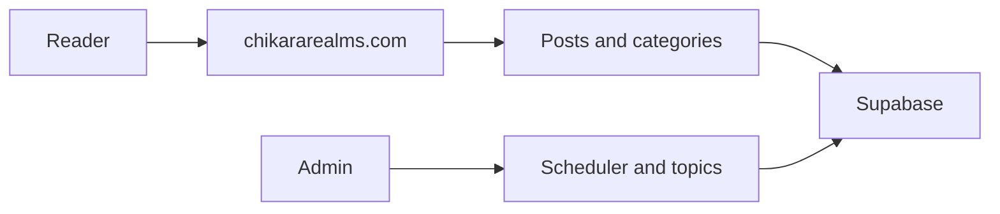

# How it works

Chikara Realms is a public blog about investing and mindset. Readers use it at [chikararealms.com](https://chikararealms.com). The application code is not in cjm-dev.

## Product

Guests can read posts, browse categories, and explore. An account can save posts and follow categories. Admins manage posts, topics, the scheduler, comments, distribution, and related settings.

## Main flow

The site is a web app with a Supabase backend. Publishing and admin tools live in that app. cjm-dev does not run the blog pipeline.

## Where the code lives

GitHub: [StaticxViper/chikararealms](https://github.com/StaticxViper/chikararealms).

That repository stays separate. Do not copy it into cjm-dev. When the site's behavior changes, update this page and the changelog here.
