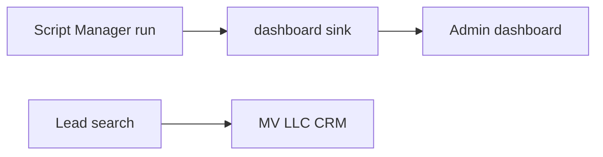

# How it works

MV LLC Admin Dashboard is the personal hub for APIs, webhooks, devices, goals, tasks, and analytics. The portfolio lists the same app as Personal admin dashboard. The app's own code is not in cjm-dev, and its GitHub repo is not recorded here yet.

## What this repo does with it

Two connections, and they are not the same call:

- The Script Manager `dashboard` sink POSTs a run summary to `SCRIPT_MANAGER_DASHBOARD_URL`. The bearer token is `CRM_MCP_MV_LLC`. The host has to be on `SCRIPT_MANAGER_CALLBACK_HOSTS`. A sink failure is recorded on the run. It does not change the script's exit code.
- Lead search can create CRM leads over the MV LLC CRM MCP server when its output mode is dashboard or both. That writes leads. It does not POST the run summary.

Screen-level behavior of the dashboard lives in the other repo. When that behavior changes, update this page and the changelog here. Add the GitHub owner, name, and URL to `documentation/apps/catalog.json`. Leave that repo separate.

## Diagrams

- [Data flow](site:repo-map/data-flow.html) shows where dashboard output sits next to JSON, CRM, and the property portal.
- [Script Manager](site:repo-map/script-manager.html) is the runner that selects the sink.
