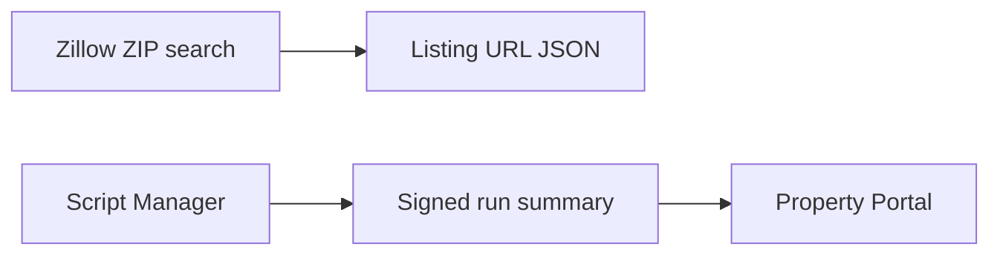

# How it works

Property Portal is the listing app, including the v2 line. The screens live in another repo. That repo is not recorded here yet. cjm-dev does not render the portal. It prepares listing URLs and can notify the portal that a script run finished.

## What this repo does with it

- `property_listing_gen.py` asks the Zillow ZIP Apify actor for listings and writes a JSON list of property URLs. The actor returns richer cards. This script keeps the URLs. It does not POST that file to the portal.
- The Script Manager `property_portal` sink POSTs the run summary, signed with `SCRIPT_MANAGER_CALLBACK_SECRET`, to `SCRIPT_MANAGER_PROPERTY_PORTAL_URL`. The host has to be on `SCRIPT_MANAGER_CALLBACK_HOSTS`. The signature header is `X-Script-Manager-Signature`.

Those are the only portal contracts in this repo. Portal screens, accounts, and v2-only behavior get described here after they change, in the same documentation update. Put the GitHub owner, name, and URL in the catalog when you have them. Do not add that repo to cjm-dev.

## Diagrams

- [Zillow diagram](site:repo-map/zillow.html)
- [Data flow](site:repo-map/data-flow.html)
