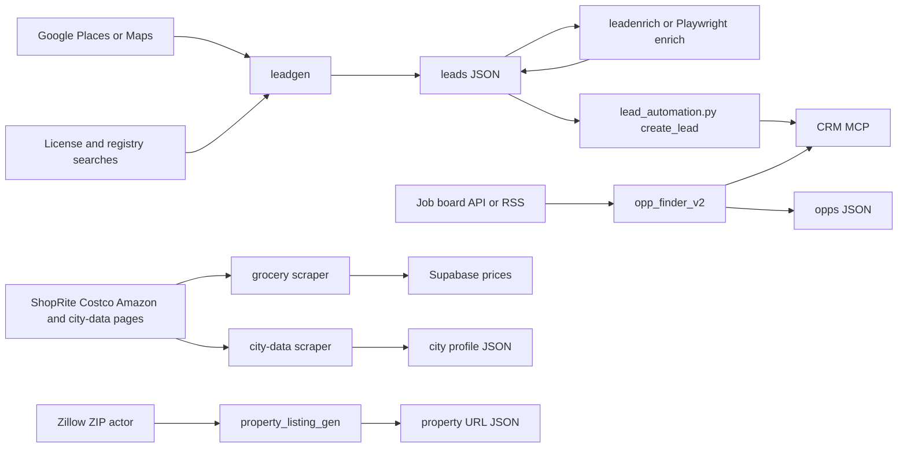

# Data flow

Searches and APIs enter through a scraper or client. Enrichment fills contact and score fields. Results land in JSON or CSV, the CRM, the dashboard, or the property portal. The workflow named on each path is the GitHub Actions file that runs it. Local runs use the Script Manager, which is the same entry the workflows call.

## Paths and workflows

- **Lead search.** `leadgen.py` reads Places or Maps, or new-business registry sources, and writes `scripts/lead_automation/*leads_output*.json`. Facebook and Playwright enrichers update that JSON. `lead_automation.py` posts `create_lead` to the CRM MCP server. Script Manager names: `leadgen`, `leadenrich`, `leadenrich-playwright`, `lead-ingest`. Workflow: [script_manager.yml](../../.github/workflows/script_manager.yml). Schedules: [script_manager_schedule.yml](../../.github/workflows/script_manager_schedule.yml).
- **Job search.** `opp_finder_v2` reads board APIs, RSS, or guest Playwright, writes `scripts/opp_finder_v2/output/opps_<timestamp>.json`, and uploads kept rows to the CRM. Workflow: [opp_finder_v2.yml](../../.github/workflows/opp_finder_v2.yml) for a manual search. Tests run in [ci.yml](../../.github/workflows/ci.yml). The Script Manager name `opp-finder-v2` is also dispatchable from `script_manager.yml` once the registry marks it active.
- **Grocery.** `grocery.scraper` reads public product pages and writes price fields to Supabase. No grocery workflow file. Run it locally or dispatch `grocery` from `script_manager.yml`.
- **City profiles.** `city_data_scraper.py` writes JSON profiles. The same scraper is packaged as an Apify Actor. Tests run in [ci.yml](../../.github/workflows/ci.yml). A manual Script Manager run uses `city-data` via `script_manager.yml`.
- **Zillow.** `property_listing_gen.py` calls the Zillow ZIP Apify actor and writes a JSON list of listing URLs for the property portal path. Script Manager name `property-listing-gen`, workflow `script_manager.yml`.
- **Dashboard and portal sinks.** Script Manager sinks `dashboard` and `property_portal` are selected on a dispatch of `script_manager.yml` (`outputs` input). They receive the run summary and artifacts. They do not replace the JSON files above.
- **Repo map site.** [pages.yml](../../.github/workflows/pages.yml) publishes this documentation. It does not run the scrapers.
